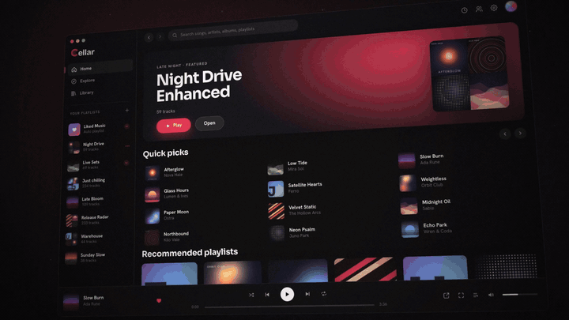
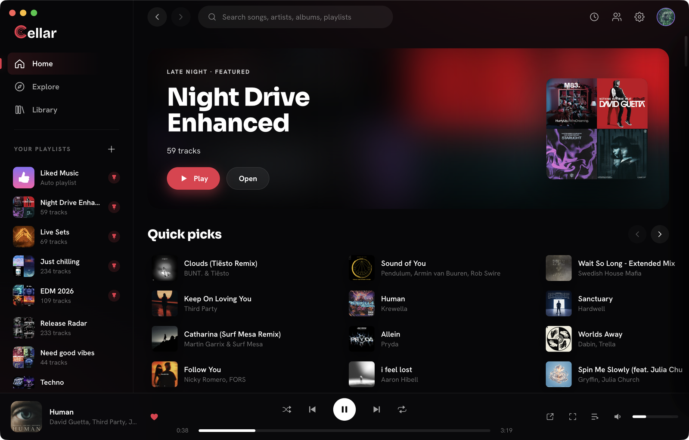
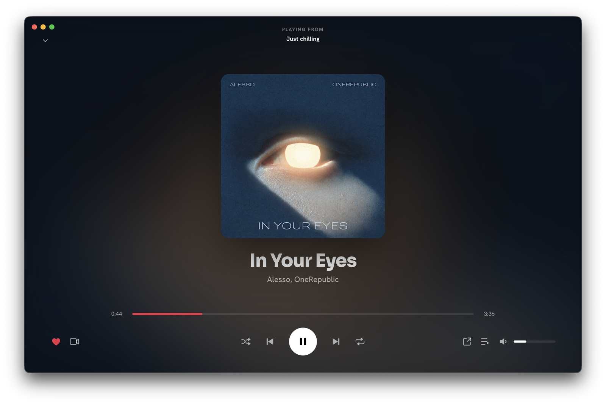
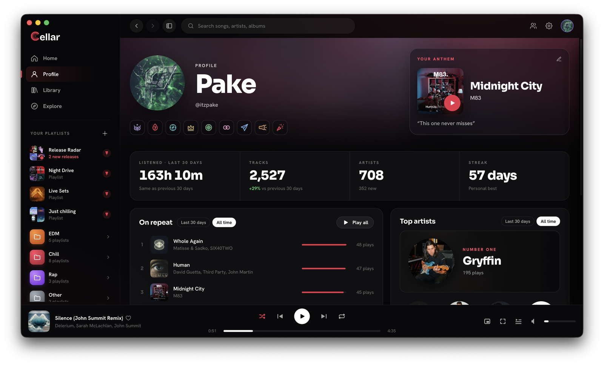
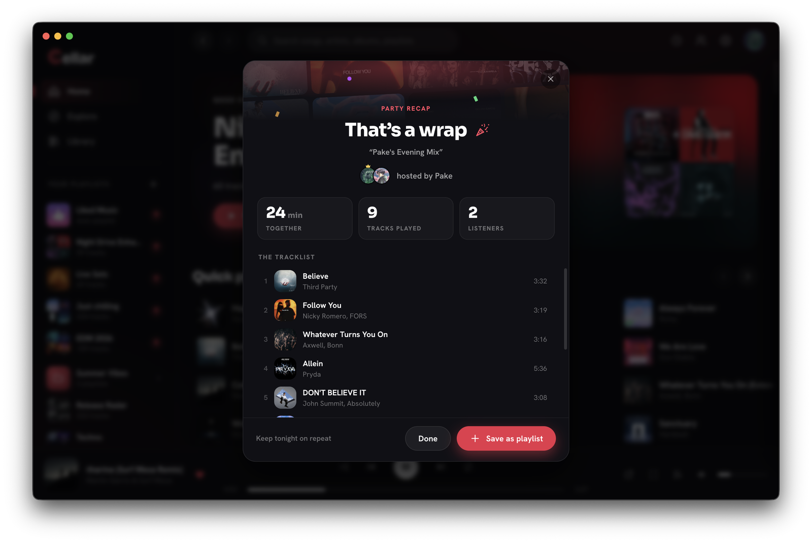

<a href="https://cellar.fm">
  <picture>
    <source media="(prefers-color-scheme: dark)" srcset=".github/assets/logo-light-text.svg">
    
  </picture>
</a>

### The YouTube Music desktop app Google never made.

Free for **macOS**, **Windows** and **Linux**. Sign in with your own account, hit play, stay in the music.

 

## Why Cellar

YouTube Music on a computer is a browser tab. Cellar turns it into a real app, keeps
your library, likes and playlists exactly as they are, and adds the things YouTube
Music never shipped:

- **Playlist folders.** File playlists into colored folders with drag and drop.
- **Listening parties.** Play in sync with friends. The host has the aux, guests suggest songs, and everyone gets a recap when the night wraps.
- **Your stats, any day.** Listening time, top songs, top artists, streaks and badges on a live profile. Not just once a year.
- **Discord Rich Presence.** Song, artist, cover and a progress bar in your status, laid out the way you choose.
- **Last.fm and Libre.fm.** Scrobble to one or both, no browser extension needed.
- **Release Radar.** Every new single, EP and album from the artists you follow, grouped by week, with a desktop alert.
- **Gapless and crossfade.** Seamless album playback by default, crossfade from 1 to 12 seconds, and volume normalization.
- **Mini player.** A small always-on-top card with cover art or video that floats above everything else.

<table>
  <tr>
    <td width="50%"></td>
    <td width="50%"></td>
  </tr>
  <tr>
    <td align="center"><b>Home</b> · your feed, playlists and folders in one window</td>
    <td align="center"><b>Now playing</b> · lyrics, video mode and comments a click away</td>
  </tr>
  <tr>
    <td width="50%"></td>
    <td width="50%"></td>
  </tr>
  <tr>
    <td align="center"><b>Profile</b> · listening time, on repeat, top artists, streaks</td>
    <td align="center"><b>Party recap</b> · save the night as a playlist</td>
  </tr>
</table>

<b>And a lot more</b>

 

- **⌘K / Ctrl+K command palette** for your whole library, songs included, plus quick commands
- **Synced lyrics**, **music video mode** with quality picker, fullscreen and an optional ambilight glow
- **YouTube comments** in Now Playing, with clickable timestamps and **DJ set tracklists** on the scrubber
- **Friends**: see what they are playing, send them a track, react with 🔥, listen along
- **Autoplay and radio** from any song, album or playlist
- **Drag and drop** songs onto playlists or the queue, with multi-select
- Media keys, taskbar controls, mouse back / forward buttons and a full keyboard workflow
- **Updates itself** at launch, signed by us. The Mac app is signed and notarized by Apple

## Download

| Platform | Requirements | Get it |
|---|---|---|
| macOS | macOS 13 or newer, Apple Silicon (M1 or newer) | [Download `.dmg`](https://cellar.fm/download/mac) |
| Windows | Windows 10 or 11, 64-bit | [Download `.exe`](https://cellar.fm/download/windows) |
| Linux | x86_64, self-updating AppImage | [Download `.AppImage`](https://cellar.fm/download/linux) |

All builds are also on the [releases page](https://github.com/timlangner/cellar/releases/latest).
Cellar is free with no subscription. If you want to help keep the servers running,
you can [buy a coffee](https://ko-fi.com/cellarfm).

## FAQ

<b>Do I need YouTube Premium?</b>

You need a YouTube Music account. YouTube Premium perks, including ad-free listening and
Premium audio, are Google's and stay with Google. Cellar is the client and doesn't change them.

<b>Does Cellar see my Google password?</b>

No. You sign in on Google's own page in a real browser, and Cellar never sees your password.
Your session stays on your computer. The [privacy policy](https://cellar.fm/privacy) has the details.

<b>Will my library and playlists carry over?</b>

Yes. Cellar talks to YouTube Music with your own account, so your likes, playlists, albums and
subscriptions are the same ones you see on music.youtube.com and on your phone.

## Feedback and bugs

The fastest way is **Help ▸ Report a Bug** in the app (or <kbd>⌘</kbd>/<kbd>Ctrl</kbd>+<kbd>Shift</kbd>+<kbd>B</kbd>):
it attaches a screenshot and the details we need. You can also
[open an issue](https://github.com/timlangner/cellar/issues/new) with your app version, platform and
what you were doing, or email [support@cellar.fm](mailto:support@cellar.fm).

 

Cellar is an independent project and is not affiliated with, or endorsed by, YouTube or Google.
